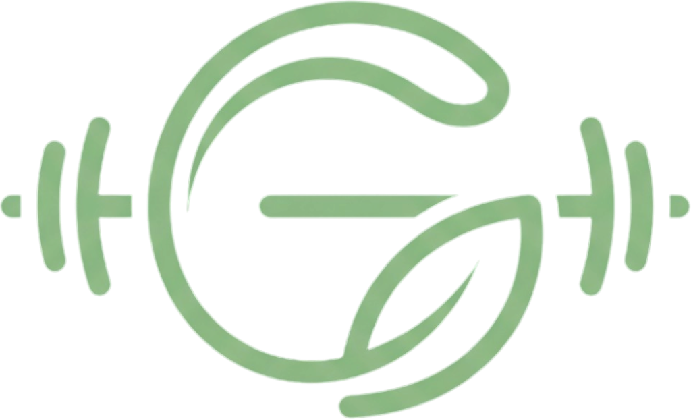

<p align="center">
  
</p>

<h1 align="center">Gymlicious</h1>

<p align="center">
  A private, offline-first workout tracker for Android and iOS.<br>
  No accounts. No ads. No tracking. Your data stays on your phone.
</p>

<p align="center">
  <a href="LICENSE">MIT licensed</a> ·
  <a href="docs/privacy-policy.md">Privacy policy</a> ·
  <a href="CONTRIBUTING.md">Contributing</a>
</p>

---

## What it does

- **One-tap daily check-in.** "Did you work out today?" Tap once. Backfill past days, plan future ones.
- **Streaks that forgive.** Set a weekly goal (1–6 days, Sunday is a rest day). Skipped days never break a streak; only a week that can no longer reach its goal does.
- **Workout logging by split.** Push/Pull/Legs and friends, with last and max weight per exercise, prefilled sets and personal-record moments.
- **Stats, XP, levels and badges.** Gentle, positive, never shaming.
- **Year Dots.** The whole year as dots, plus an Android live wallpaper.
- **Backups you own.** One JSON file you can save anywhere or send to yourself on WhatsApp. Restore any time.
- **Light and YouTube-style dark themes**, phones and tablets, up to 200% text.

The only network traffic is fetching motivational quotes from a public, key-less API, which sees your IP address and nothing else. Quotes can be turned off.

## Build and run

Requirements: Flutter 3.47.7 (Dart 3.13.5), Android Studio's JDK 21 for Android, Xcode on macOS for iOS.

```sh
cd mobile
flutter pub get
flutter run --flavor dev --dart-define-from-file=config/dev.json
```

| Flavor | Android app ID | Use |
|--------|----------------|-----|
| `dev` | `com.kayiro.gymlicious.dev` | Everyday development |
| `staging` | `com.kayiro.gymlicious.staging` | Device tests (they wipe their own data) |
| `prod` | `com.kayiro.gymlicious` | Store builds |

More in [mobile/README.md](mobile/README.md). Releasing and signing: [docs/releasing.md](docs/releasing.md).

## Repository

| Path | What |
|------|------|
| `mobile/` | The Flutter app, including the Kotlin live wallpaper |
| `design-tokens/` | Colours, spacing and type; generates Dart and Kotlin code |
| `shared-test-vectors/` | Year Dots layout vectors shared by the Dart and Kotlin tests |
| `branding/` | The Gymlicious logo source; icons are generated from it |
| `docs/` | Spec, architecture, decisions, ADRs, privacy policy, release guide |

Start with [docs/architecture.md](docs/architecture.md) and [docs/adding-a-feature.md](docs/adding-a-feature.md).

## Forking

You are welcome to fork and ship your own build. Please give it **your own name, logo and app ID**: the code is MIT licensed, but the Gymlicious name and logo are not (see [NOTICE.md](NOTICE.md)). Change `applicationId` in `mobile/android/app/build.gradle.kts`, `PRODUCT_BUNDLE_IDENTIFIER` in `mobile/ios/Runner.xcodeproj/project.pbxproj`, the `appTitle` string, and replace `branding/gymlicious-logo.png`, then run `flutter test tool/app_icon/generate_app_icons_test.dart`.

## License

Code: [MIT](LICENSE). Fonts, icons and other third-party material keep their own licenses: see [NOTICE.md](NOTICE.md).
