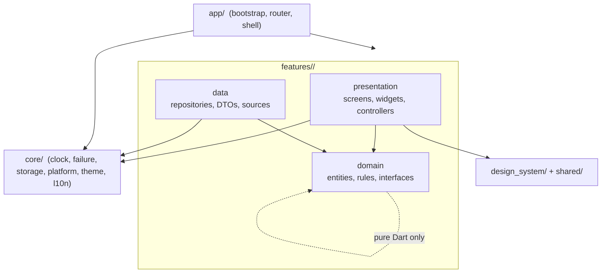
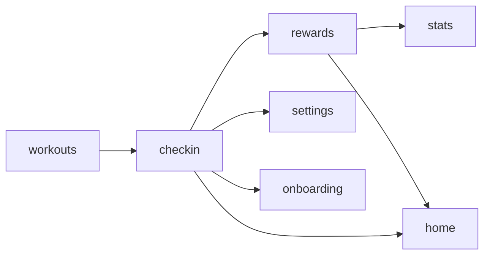
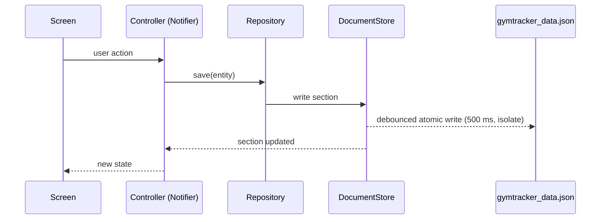
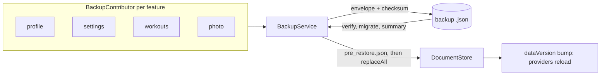

# Architecture

A Flutter app with no backend. All user data stays on the device; the only network traffic is fetching quotes from public APIs.

## Layers

Rules, enforced by `mobile/test/architecture/layer_boundaries_test.dart`:
- `domain/` imports only Dart, `core/` pure files and other features' `*_domain.dart`.
- A feature imports another feature only through its public file `features/<name>/<name>.dart` (or `<name>_domain.dart`).
- Widgets hold no business rules; controllers call domain rules and repositories.
- External dependencies sit behind interfaces provided by Riverpod: `DataStore`, `FileGateway`, `ShareGateway`, `WallpaperGateway`, `NotificationGateway`, `QuoteSource`, `Clock`.

## Features and dependencies

Tabs: Home, Plan (`checkin`), Train, Stats, Me (`settings`). Exercises, history, Year Dots and badges open as full-screen routes. In the diagram, `A --> B` means B uses A.

- `checkin` owns the `checkIns` section (one entry per date, plus goal history) and the `StreakCalculator`. A day counts as done when the user ticked it, or when a session started that day and the user never chose otherwise.
- `rewards` owns the `rewards` section (badges, kept once earned). XP and levels are recomputed from days, sessions and weeks. `CelebrationHost` sits above the router and turns real changes into one short celebration.
- `stats` owns no data.

## Feature registry

Each feature exports a `FeatureModule`: its data sections, an optional tab, routes, backup contributors and a `clearLocalData` hook. `app/app_modules.dart` lists them. The router, shell, store loader, backup service and reset all read from that list, so adding a feature does not touch other features.

## Data flow

On start, `bootstrap()` loads the file (falling back to `.bak`), migrates it, and loads seed data and bundled quotes before the first frame. A corrupt store routes to the recovery screen; a missing profile routes to the welcome gate.

## Backup flow

## Native code

- **Android** (`android/app/src/main/kotlin/…`): `channels/ShareChannel` (direct WhatsApp share through a `FileProvider`), `channels/WallpaperChannel` (stores wallpaper config in `SharedPreferences`, opens the live-wallpaper preview), and `wallpaper/` (the Year Dots `WallpaperService`, with a Kotlin port of `DotLayout`; no Flutter engine).
- **iOS**: no custom native code in v1. The wallpaper is an exported image.
- `design-tokens/tokens.json` generates both the Dart theme tokens and the Kotlin wallpaper palette. `shared-test-vectors/` keeps the Dart and Kotlin layouts identical.
